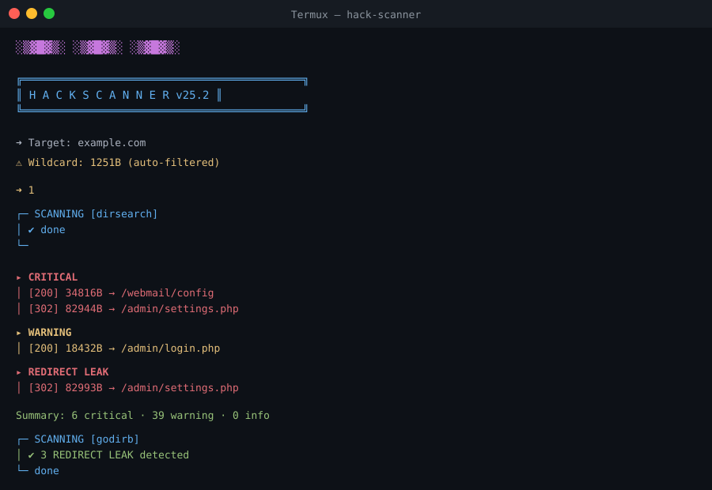

# Hack Scanner v25.2

> Portable path scanner for security research — **dirsearch + godirb + ffuf** with redirect leak detection.



[](https://opensource.org/licenses/MIT)
[]()
[]()

## ✨ Features

- 🎯 **3 scanners** — dirsearch, godirb, ffuf (auto-installed)
- 🕵️ **Wildcard detection** — auto-filters fake responses
- 🔥 **Redirect Leak detection** — detects sensitive data in 301/302 bodies
- 🎨 **Cinematic UI** — color-coded severity
- 📱 **Portable** — Termux (ARM64), Linux, macOS (AMD64)
- ⚡ **Zero config** — first run installs everything
- 🚀 **One-command launch** — `kaha` from anywhere

## 🚀 Install

```bash
git clone https://github.com/karim362/hack-scanner.git hack
cd hack
./install.sh
source ~/.bashrc
